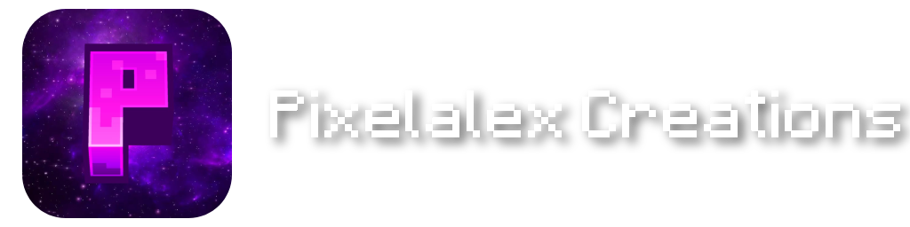

# Syntax reference

Every block shows the Markdown first and the result below it.

## Text

```md
**Bold**, *italic*, ~~strikethrough~~ and `inline code`.
A single line break stays a line break.
```

**Bold**, *italic*, ~~strikethrough~~ and `inline code`.
A single line break stays a line break.

## Colors

Names come from `color_map.json`. Hex colors work too, and colors can be nested.

```md
[gold]Gold[/], [material_diamond]diamond[/], [#ff55ff]any hex color[/] and [red]red with [aqua]aqua[/] inside[/].
```

[gold]Gold[/], [material_diamond]diamond[/], [#ff55ff]any hex color[/] and [red]red with [aqua]aqua[/] inside[/].

## Headings

```md
# Page title
## Section
### Subsection
```

Every heading gets an anchor. Hover it and click the `#` to get a direct link to that section.

## Links

```md
[A page of this project](installation)
[A section on this page](#tables)
[A section on another page](installation#where-is-the-mods-folder)
[A page of another project](other_project/overview)
[The start page of another project](other_project/)
[An external site](https://modrinth.com)
```

[A page of this project](installation)
[A section on this page](#tables)
[A section on another page](installation#where-is-the-mods-folder)
[An external site](https://modrinth.com)

## Images

Paths are relative to the project folder, so `images/menu.png` means `content/<project>/images/menu.png`.

```md
{width=320 align=center caption="Size, alignment and caption are optional"}
```

{width=320 align=center caption="Size, alignment and caption are optional"}

| Option | Values |
|---|---|
| `width`, `height` | a number in pixels, or `50%`, `20em` |
| `align` | `left`, `center`, `right` |
| `caption` | text in quotes |
| `pixelated` | keeps pixel art sharp when scaled up |
| `nozoom` | disables the click to enlarge |

Click any image to see it larger.

## Icons

```md
Join us on :icon[../../assets/images/discord-icon.png] Discord.
Bigger: :icon[../../assets/images/discord-icon.png]{size=32}
```

Join us on :icon[../../assets/images/discord-icon.png] Discord.
Bigger: :icon[../../assets/images/discord-icon.png]{size=32}

## Loaders

Names and colors come from `loaders.json`. Unknown names show as a gray chip.

```md
:loader[Fabric, Forge, NeoForge, Quilt, Java Agent]
:loader[Paper, Spigot, Iris, Something Else]
```

:loader[Fabric, Forge, NeoForge, Quilt, Java Agent]
:loader[Paper, Spigot, Iris, Something Else]

## Tables

```md
| Command | Permission | Description |
|---|:---:|---|
| `/example help` | none | Shows the help |
| `/example reload` | OP | Reloads the config |
```

| Command | Permission | Description |
|---|:---:|---|
| `/example help` | none | Shows the help |
| `/example reload` | OP | Reloads the config |

A colon on the left, right or both sides of the dashes aligns the column.

## Lists

```md
- First
- Second
    - Nested

1. Step one
2. Step two

- [x] Done
- [ ] Not done
```

- First
- Second
    - Nested

1. Step one
2. Step two

- [x] Done
- [ ] Not done

## Quotes

```md
> Quoted text
```

> Quoted text

## Code blocks

````md
```json
{ "enabled": true }
```
````

```json
{ "enabled": true }
```

## Collapsible sections

```md
::: details Click to open
Hidden content.
:::

::: details+ Open by default
Visible content.
:::
```

::: details Click to open
Hidden content.
:::

::: details+ Open by default
Visible content.
:::

## Callouts

```md
::: info
Default title.
:::

::: tip Own title
Content.
:::
```

::: info
An info box.
:::

::: tip Own title
A tip box.
:::

::: warning
A warning box.
:::

::: danger
A danger box.
:::

## Tabs

```md
::: tabs
@tab Fabric
Fabric content
@tab Quilt
Quilt content
:::
```

::: tabs
@tab Fabric
Fabric content
@tab Quilt
Quilt content
:::

Tabs with the same name stay in sync across the whole page.

## Changelog

Renders exactly like the changelogs on the website.

```md
::: changelog
## v1.1
- [green]Added[/] new items
- [red]Removed[/] old stuff
- **Fixed** a crash
:::
```

::: changelog
## v1.1
- [green]Added[/] new items
- [red]Removed[/] old stuff
- **Fixed** a crash
:::

## Divider

```md
---
```

---

## Escaping

Put a backslash in front of a character to show it as it is.

```md
\*not italic\* and \[gold]no color\[/]
```

\*not italic\* and \[gold]no color\[/]

## Crafting recipes

Letters in the grid point to the items below it, `.` is an empty slot. `|` between items makes the slot cycle through them. Hover an item to see its name.

```md
::: crafting
. A .
. A .
. B .
A: images/items/ruby.png "Ruby"
B: images/items/stick.png "Stick"
=> images/items/ruby_sword.png "Ruby Sword"
:::
```

::: crafting
. A .
. A .
. B .
A: images/items/ruby.png "Ruby"
B: images/items/stick.png "Stick"
=> images/items/ruby_sword.png "Ruby Sword"
:::

```md
::: crafting shapeless
A B .
. . .
. . .
A: images/items/ruby.png "Ruby" | images/items/ruby_dust.png "Ruby Dust"
B: images/items/stick.png "Stick"
=> images/items/ruby_dust.png "Ruby Dust" x4
:::
```

::: crafting shapeless
A B .
. . .
. . .
A: images/items/ruby.png "Ruby" | images/items/ruby_dust.png "Ruby Dust"
B: images/items/stick.png "Stick"
=> images/items/ruby_dust.png "Ruby Dust" x4
:::

## Furnace recipes

```md
::: furnace
input: images/items/ruby_ore.png "Ruby Ore"
=> images/items/ruby.png "Ruby"
:::
```

::: furnace
input: images/items/ruby_ore.png "Ruby Ore"
=> images/items/ruby.png "Ruby"
:::

## Brewing recipes

Potions are colored automatically. Use `potion`, `splash_potion` or `lingering_potion` with a color.

```md
::: brewing
ingredient: images/items/ruby_dust.png "Ruby Dust"
input: potion #385dc6 "Water Bottle"
=> potion #c43c3c "Potion of Fire Heart"
:::
```

::: brewing
ingredient: images/items/ruby_dust.png "Ruby Dust"
input: potion #385dc6 "Water Bottle"
=> potion #c43c3c "Potion of Fire Heart"
:::

## Videos

The player only loads after a click.

```md
::: youtube https://youtu.be/du8RUJlSZ5Y A beautiful ocean
Optional description below the title.
:::
```

::: youtube https://youtu.be/du8RUJlSZ5Y A beautiful ocean
Optional description below the title.
:::

## Galleries

```md
::: gallery


:::
```

::: gallery


:::

## Text alignment

Add `{.center}` or `{.right}` at the end of a paragraph or heading. Without it, text is left aligned.

```md
## Centered heading {.center}

This paragraph is centered. {.center}

This one is right aligned. {.right}
```

## Centered heading {.center}

This paragraph is centered. {.center}

This one is right aligned. {.right}