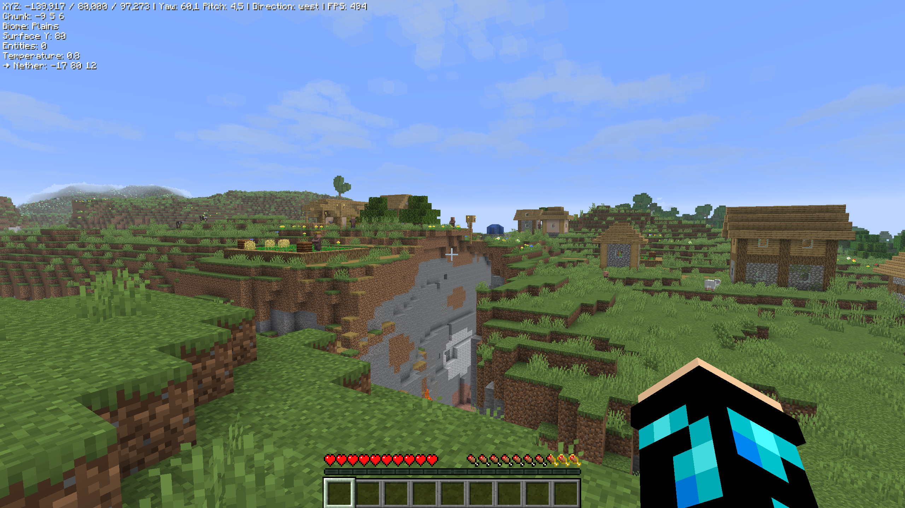

Pixels F3 adds a small HUD overlay that works like a cleaner version of the F3 screen. It only shows the debug info you actually need, in a compact block in the top left corner.

:loader[Fabric, Quilt]

{width=800 align=center caption="The F3 HUD"}

## Showing the HUD

Press **C** to toggle the overlay. The key is called **Toggle F3 HUD** and can be changed in the controls under the **Misc** category.

The overlay is hidden every time you start the game.

## What the HUD shows

| Info | Description |
|---|---|
| XYZ | Your exact position |
| Yaw / Pitch | Where you are looking, horizontally and vertically |
| Direction | The direction you are facing: north, east, south or west |
| FPS | Your current frames per second |
| Chunk | The chunk you are in (X, Y section, Z) |
| Biome | The biome at your position |
| Surface Y | The height of the world surface at your position |
| Entities | Entities within 32 blocks horizontally and 16 blocks vertically, not counting yourself |
| Temperature | The base temperature of the biome |
| Coordinate conversion | In the Overworld: your matching Nether coordinates. In the Nether: your matching Overworld coordinates. In other dimensions: the dimension ID |

The text color can be changed in the [configuration](configuration).

## Supported versions

| Minecraft     | Loader                 | Status              |
| :-----------: | :--------------------: | :-----------------: |
| 26.3          | :loader[Fabric, Quilt] | [green]Supported[/] |
| 26.2          | :loader[Fabric, Quilt] | [green]Supported[/] |
| 26.1 – 26.1.2 | :loader[Fabric, Quilt] | [green]Supported[/] |
| 1.21.11       | :loader[Fabric, Quilt] | [green]Supported[/] |
| 1.21.10       | :loader[Fabric, Quilt] | [green]Supported[/] |

Downloads are available on [Pixelalex Creations](https://www.pixelalexcreations.net/mods/#pixels_f3).
