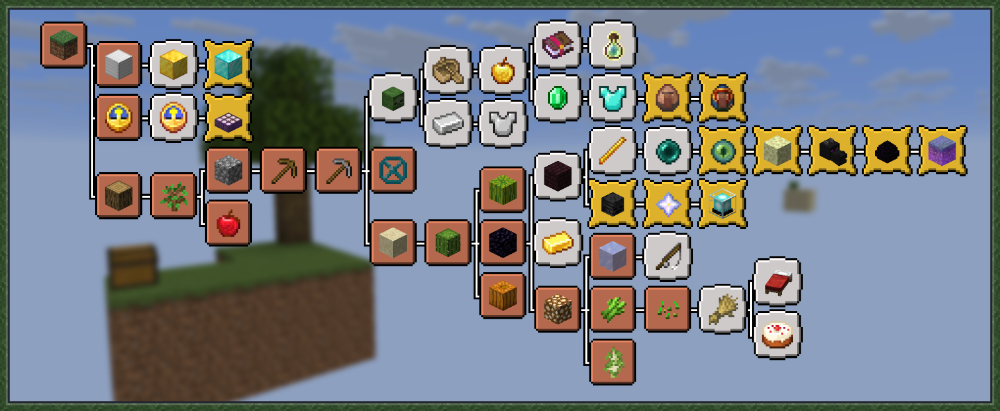

All original advancements are disabled. Pixels Skyblock has its own **Skyblock** tab with 51 custom advancements that follow the progression of the map.

{width=800 align=center caption="Custom Advancements"}

## Tiers

Instead of task, goal and challenge, advancements are split into tiers:

| Tier | Vanilla equivalent | Advancements |
| :---: | :---: | :---: |
| [material_copper]Copper[/] | Task | 19 |
| [material_iron]Iron[/] | Goal | 19 |
| [material_gold]Gold[/] | Challenge | 11 |
| [material_diamond]Diamond[/] | – | 1 |

The 51st advancement is the root of the tab, **Skyblock**. You get it automatically when you join the world, together with a welcome message.

When you get an advancement, a colored message appears in the chat. Hover over the name to see the description.

## [material_copper]Copper[/]

| Advancement | Description | Requirement |
|---|---|---|
| Timber! | Chop down your first tree. | Get an oak log |
| A Lucky Day | Place a sapling that you got from the tree. | Place an oak sapling |
| Keep the Doctor Away | Get an apple from a tree. | Get an apple |
| Block by Block | Build a cobblestone generator. | Place both ice and lava |
| Stone Age | Mine your first cobblestone from a generator. | Get cobblestone |
| Stone Tools Ready | Craft a full stone tool set. | Get a stone axe, hoe, pickaxe and shovel |
| Risk Taker | Touch the Void. | Go below Y -64 |
| Sandy Deal | Reach the sand island and loot the chest. | Collect 10 obsidian, a melon slice and pumpkin seeds |
| Prickly Pal | Break the cactus and don't let the sand fall. | Get a cactus |
| Melon Mania | Craft melon seeds and grow your first melon. | Get a melon |
| Pumpkin Patch | Plant pumpkin seeds and harvest one. | Get a pumpkin |
| Nether Arrival | Build a nether portal, ignite it by burning wood with your lava, and step through. | Travel from the Overworld to the Nether |
| Spores & Glow | Collect both mushrooms and glowstone from the Nether island. | Collect brown mushrooms, red mushrooms and glowstone dust |
| The Birch Legacy | Plant your birch sapling. | Place a birch sapling |
| Icy Repeat | Place your second ice block. | Place ice twice |
| Sugar Rush | Plant sugarcane successfully. | Place sugar cane |
| A Weedy Place | Use bonemeal to grow grass, harvest the seeds it drops, and grow them into wheat. | Get wheat |
| Platform Builder | Place 100 blocks total. | Place 100 blocks |
| Stayin' Alive | Survive 10 full days in the void. | Survive 10 in-game days |

## [material_iron]Iron[/]

| Advancement | Description | Requirement |
|---|---|---|
| Dark Harvest | Build a mob grinder and slay 50 hostile mobs. | Reach 50 mob kills |
| Iron Will | Obtain your first 3 iron ingots. | Have at least 3 iron ingots at once |
| Suit Up | Forge a full set of iron armor. | Get iron boots, chestplate, helmet and leggings |
| Hostile Wreck | Get a witch to go inside a boat with you. | Ride a boat with a witch as a passenger |
| Second Chance | Cure a zombie villager and give them a fresh start. | Cure a zombie villager |
| By the Book | Trade with a librarian for your first enchanted book. | Trade with a villager and receive an enchanted book |
| Experienced | Reach experience level 30. | Reach XP level 30 |
| Void Rich | Stockpile a full stack of emeralds from trading. | Hold a full stack of 64 emeralds |
| Cover Me with Expenses | Get a full set of diamond armor from an armorer. | Get diamond boots, chestplate, helmet and leggings |
| Reel Deal | Fish up a treasure item from the void's edge. | Fish up an enchanted book, name tag, nautilus shell, saddle, enchanted bow or enchanted fishing rod |
| Two by Two | Breed chickens, cows, pigs and sheep. | Breed chickens, cows, pigs and sheep |
| Piece of Cake | Bake a cake. | Get a cake |
| A Good Night's Sleep | Craft a bed and take a nap. | Sleep in a bed |
| Going for Gold | Refine gold from zombified piglin drops. | Get a gold ingot |
| A Non-Existent Fortress | Get within the boundaries of a nether fortress and use normal blocks or nether bricks to let mobs spawn. | Stand inside a Nether Fortress structure |
| Blaze of Glory | Claim a blaze rod from a blaze. | Get a blaze rod |
| Magic Pearl | Acquire an ender pearl from an Enderman. | Get an ender pearl |
| Continental Drift | Place 1,000 blocks total. | Place 1,000 blocks |
| Halfway There | Survive 50 full days in the void. | Survive 50 in-game days |

## [material_gold]Gold[/]

| Advancement | Description | Requirement |
|---|---|---|
| Town Mayor | Grow your village to 10 or more villagers. | Have 10 villagers within 50 blocks |
| Best Buddy | Encounter a Wandering Trader. | Have a wandering trader within about 10 blocks |
| Skull Collector | Obtain a Wither Skeleton's skull. | Get a wither skeleton skull |
| Storm in a Teacup | Summon and defeat the Wither. | Summon and kill the Wither |
| Guiding Light | Forge a Nether Star into a Beacon. | Get a beacon |
| Eye Spy | Craft Eyes of Ender and find the end portal frame. | Get an ender eye and stand inside a stronghold |
| End Game | Activate the portal and step into the End. | Travel from the Overworld to the End |
| Dragonslayer | Defeat the Ender Dragon. | Kill the Ender Dragon |
| The Ultimate Prize | Claim the Dragon Egg. | Get the dragon egg |
| Empire Builder | Place 10,000 blocks total. | Place 10,000 blocks |
| I Survived 100 Days in Skyblock | Survive 100 full days in the void. | Survive 100 in-game days |

## [material_diamond]Diamond[/]

| Advancement | Description | Requirement |
|---|---|---|
| Completionist | Get all advancements and complete Skyblock. | Complete every other advancement |

::: tip
Completionist is hidden until you unlock it.
:::
