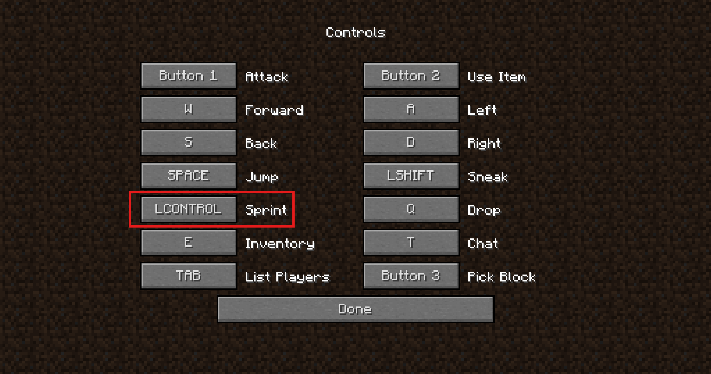

Pixels Sprinting Key adds a key for sprinting to Minecraft 1.0.0. In this version you can normally only sprint by double-tapping the forward key. With this mod you hold one key instead, just like in newer versions.

:loader[Java Agent]

## Features

- Adds a keybind for sprinting
- The key can be changed in the options
- Defaults to **Ctrl**

::: info Client-side only
The mod only changes your game. It does not have to be installed on a server.
:::

## Changing the key

Open **Options › Controls** and click the button next to **Sprint**.

{width=640 align=center caption="The new Sprint keybind in the controls"}

## Supported versions

| Minecraft | Mod version | Loaders | Status |
|---|---|---|---|
| 1.0.0 | v1.0 | :loader[Java Agent] | [green]Supported[/] |

Ready to install? Continue with [Installation](installation).
