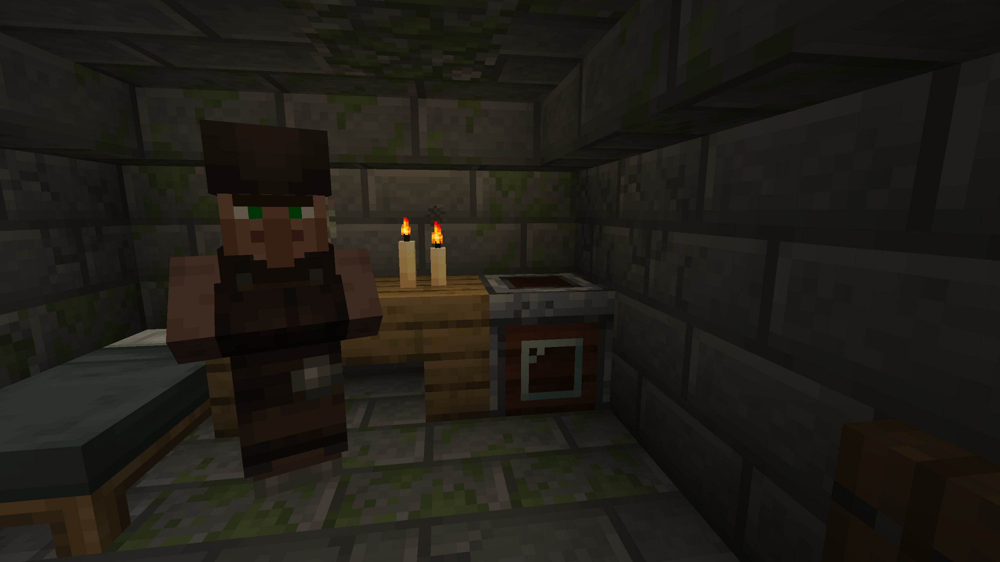

# :icon[images/items/cleaning_station.png]{size=36} Cleaning Station

The Cleaning Station is a workstation for cleaning [Muddy Items](muddy_items). It works similar to a Furnace, but uses [Soap Bars](soap_bars) instead of fuel and needs water to run. It is also the job site block of the [Gravedigger](gravedigger).

{width=800 align=center caption="The Gravedigger Villager with the Cleaning Station"}

## Crafting

::: crafting
A A A
B C B
B D B
A: images/items/iron_ingot.png "Iron Ingot"
B: images/items/oak_planks.png "Oak Planks" | images/items/spruce_planks.png "Spruce Planks" | images/items/birch_planks.png "Birch Planks" | images/items/jungle_planks.png "Jungle Planks" | images/items/acacia_planks.png "Acacia Planks" | images/items/dark_oak_planks.png "Dark Oak Planks" | images/items/mangrove_planks.png "Mangrove Planks" | images/items/cherry_planks.png "Cherry Planks" | images/items/pale_oak_planks.png "Pale Oak Planks" | images/items/poplar_planks.png "Poplar Planks" | images/items/bamboo_planks.png "Bamboo Planks" | images/items/crimson_planks.png "Crimson Planks" | images/items/warped_planks.png "Warped Planks"
C: images/items/glass_pane.png "Glass Pane"
D: images/items/cauldron.png "Cauldron"
=> images/items/cleaning_station.png "Cleaning Station" x1
:::

Any type of planks works. Cleaning Stations can also be found in [Graveyards](graveyard).

## How to use it

The Cleaning Station has four slots:

| Slot | What goes in |
|---|---|
| Input | A Muddy Item |
| Soap | A Soap Bar |
| Water | A Water Bucket or a Water Bottle |
| Output | The cleaned item |

1. Fill the station with water.
2. Put a Muddy Item into the input slot and a Soap Bar into the soap slot.
3. Wait until the cleaning is done and take the result out of the output slot.

The station only starts when the output slot is empty.

### Water

Each cleaned item uses up one unit of water. The station holds up to 18 units.

| Water source | Adds | Used when |
|---|:---:|---|
| Water Bucket | 18 units | The station is completely empty |
| Water Bottle | 6 units | At least 6 units are missing |

The empty Bucket or Glass Bottle stays in the water slot. While there is water in the station, you can see it inside the block.

::: tip
A Water Bucket is only used once the station is completely empty, so you can leave a bucket in the slot as a refill.
:::

### Soap

Each cleaning uses one use of the Soap Bar. The soap tier decides how long the cleaning takes and how good the result is, see [Soap Bars](soap_bars).

## Automation

The Cleaning Station works with Hoppers, similar to a Furnace:

| Side | Hopper inserts | Hopper extracts |
|---|---|---|
| Top | Muddy Items | – |
| Sides | Soap Bars, Water Buckets, Water Bottles | – |
| Bottom | – | Cleaned items, empty Buckets and Glass Bottles |

A Comparator reads the contents of the station.

While cleaning, the station shows particles and plays a sound.

## Results

All results are chosen randomly. The chance depends on the soap tier.

::: details Tools and weapons
Applies to Muddy Sword, Spear, Pickaxe, Axe, Shovel and Hoe.

| Result | Crude | Refined | Purified |
|---|:---:|:---:|:---:|
| Wooden | 40% | 12% | 2% |
| Stone | 25% | 20% | 5% |
| Golden | 15% | 15% | 8% |
| Copper | 10% | 15% | 15% |
| Iron | 7% | 22% | 20% |
| Diamond | 2% | 12% | 25% |
| Netherite | 1% | 3% | 15% |
| [#e85af5]Spirit Crystal[/] | – | 1% | 10% |
:::

::: details Chestplate, Leggings and Boots
| Result | Crude | Refined | Purified |
|---|:---:|:---:|:---:|
| Leather | 40% | 12% | 2% |
| Chainmail | 25% | 20% | 5% |
| Golden | 15% | 15% | 8% |
| Copper | 10% | 15% | 15% |
| Iron | 7% | 22% | 20% |
| Diamond | 2% | 12% | 25% |
| Netherite | 1% | 3% | 15% |
| [#e85af5]Spirit Crystal[/] | – | 1% | 10% |
:::

::: details Helmet
| Result | Crude | Refined | Purified |
|---|:---:|:---:|:---:|
| Leather | 40% | 12% | 1.8% |
| Chainmail | 25% | 17% | 2.7% |
| Golden | 15% | 13% | 4.5% |
| Copper | 10% | 15% | 10.9% |
| Iron | 7% | 22% | 21.8% |
| Diamond | 2% | 12% | 19.1% |
| Netherite | 1% | 3% | 13.6% |
| Turtle Shell | – | 5% | 16.4% |
| [#e85af5]Spirit Crystal[/] | – | 1% | 9.1% |
:::

::: details Horse Armor
| Result | Crude | Refined | Purified |
|---|:---:|:---:|:---:|
| Leather | 45% | 20% | 5% |
| Copper | 20% | 22% | 15% |
| Iron | 18% | 25% | 17% |
| Golden | 10% | 15% | 18% |
| Diamond | 5% | 12% | 25% |
| Netherite | 2% | 5% | 15% |
| [#e85af5]Spirit Crystal[/] | – | 1% | 5% |
:::

::: details Nautilus Armor
| Result | Crude | Refined | Purified |
|---|:---:|:---:|:---:|
| Copper | 50% | 30% | 8% |
| Iron | 25% | 23% | 15% |
| Golden | 15% | 20% | 18% |
| Diamond | 7% | 15% | 28% |
| Netherite | 3% | 8% | 20% |
| [#e85af5]Spirit Crystal[/] | – | 4% | 11% |
:::

::: details Bundled Minerals
Cleaning Muddy Bundled Minerals gives a colored Bundle filled with one kind of mineral.

| Bundle | Contents | Crude | Refined | Purified |
|---|---|:---:|:---:|:---:|
| Black | 10–20 Coal | 12% | 9.5% | 6.2% |
| Brown | 8–16 Copper Ingots | 11% | 9.5% | 8.3% |
| Red | 8–16 Redstone Dust | 11% | 9.5% | 8.3% |
| Light Gray | 6–12 Iron Ingots | 10% | 9.5% | 8.3% |
| White | 8–16 Nether Quartz | 10% | 8.4% | 8.3% |
| Purple | 6–12 Amethyst Shards | 9% | 8.4% | 8.3% |
| Blue | 8–16 Lapis Lazuli | 9% | 8.4% | 8.3% |
| Orange | 6–12 Resin Clumps | 9% | 8.4% | 8.3% |
| Yellow | 5–9 Gold Ingots | 8% | 8.4% | 9.4% |
| Green | 8–14 Emeralds | 6% | 9.5% | 10.4% |
| Cyan | 3–6 Diamonds | 4% | 7.4% | 10.4% |
| Gray | 1 Netherite Ingot | 1% | 2.1% | 3.1% |
| Magenta | 1 [#e85af5]Spirit Crystal[/] | – | 1.1% | 2.1% |
:::

## Custom results

All results are loot tables, so you can change them with a data pack. The files are located at:

`data/spirit_scape/loot_table/cleaning/<muddy_item>_result_<tier>.json`

For example `muddy_axe_result_purified.json`. The tiers are `crude`, `refined` and `purified`. Only the first item a loot table returns is used.
