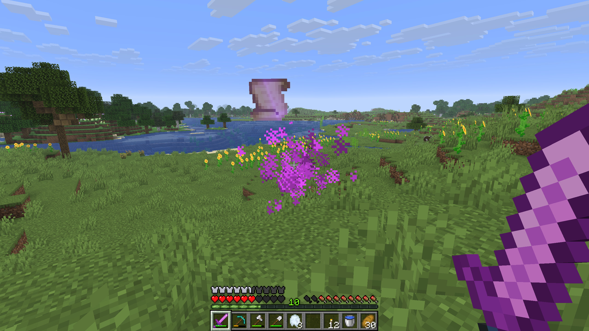

## Dimensional Rift

The Dimensional Rift is a rare world event. A rift opens near a random player and leaves a **Spirit Manifest** behind.

{width=800 align=center caption="A new random World Event"}

### How it works

- Every game tick, there is a **1 in 1,000,000** chance that a rift opens. On average, that is about once every 14 hours of playtime.
- The rift opens in the Overworld within **24 blocks** of a random player, 2 blocks above the ground.
- It only opens if the ground at that spot is at **Y 62 or higher**. Otherwise, nothing happens.
- Loud portal sounds and particles announce the rift. After about 8 seconds, a Spirit Manifest drops out of it.

Operators can open a rift with the [`/spawnevent`](commands) command.

## :icon[images/items/spirit_manifest.png]{size=30} Spirit Manifest

A mysterious item from the Spirit Realm. Its tooltip reads:

> *Within the Spirit Realm, every object leaves an echo in time.*
> *Through this vessel, those echoes are drawn into the present,*
> *giving form to things whose paths through the world remain unknown.*

- Stacks up to 4, Epic rarity.
- Comes from Dimensional Rifts, rarely from [Urns](urn) in [Graveyards](graveyard), and can be bought from a Master [Gravedigger](gravedigger) for 128 Emeralds.

::: info
During Alpha and Beta, the Spirit Manifest is used to obtain items that do not have a proper way to get them yet. It will stay in the game after the full release as an easter egg.
:::
