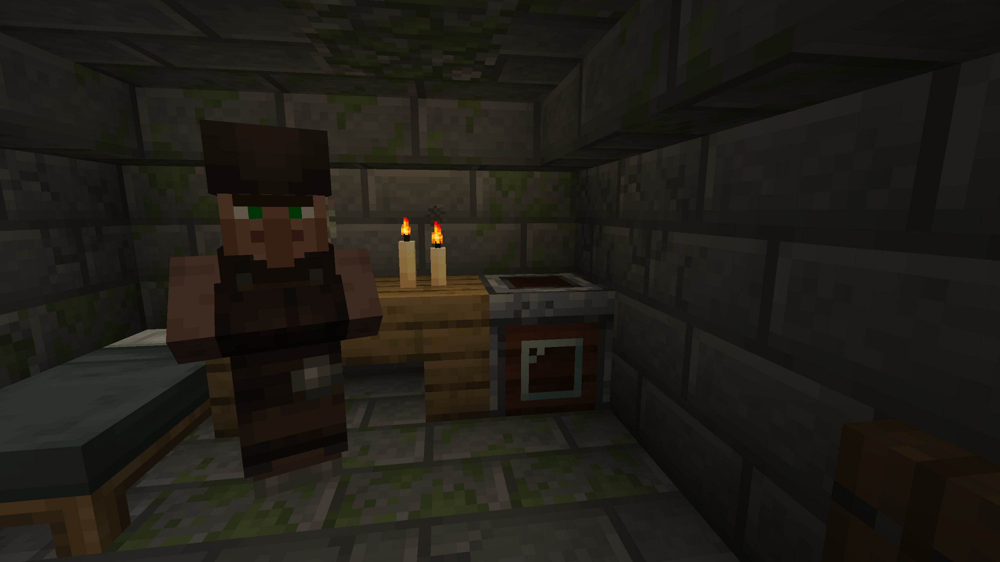

The Gravedigger is a new villager profession. He spawns naturally in [Graveyards](graveyard), and any unemployed villager can become a Gravedigger by claiming a [Cleaning Station](cleaning_station) as job site.

{width=800 align=center caption="The Gravedigger Villager with the Cleaning Station"}

## Trades

At each level, the Gravedigger offers a random selection of the trades listed.

### Novice (2 of 3)

| Wants | Gives | Max uses |
|---|---|:---:|
| 16 Rotten Flesh | 1 Emerald | 16 |
| 20 Bones | 1 Emerald | 16 |
| 3 Emeralds | 1 [Urn](urn) | 12 |

### Apprentice (2 of 2)

| Wants | Gives | Max uses |
|---|---|:---:|
| 8 Emeralds | 1 Crude [Soap Bar](soap_bars) | 8 |
| 1 Muddy Shovel | 6 Emeralds | 5 |

### Journeyman (2 of 3)

| Wants | Gives | Max uses |
|---|---|:---:|
| 3 Emeralds | 1 Name Tag | 12 |
| 22 Emeralds | 1 Refined [Soap Bar](soap_bars) | 4 |
| 24 Gunpowder | 1 Emerald | 16 |

### Expert (2 of 2)

| Wants | Gives | Max uses |
|---|---|:---:|
| 1 [Spirit Crystal](spirit_crystal) | 32 Emeralds | 5 |
| 4 [Spirit Plasma](crafting_materials#spirit-plasma) | 1 Emerald | 16 |

### Master (1 of 2)

| Wants | Gives | Max uses |
|---|---|:---:|
| 56–64 Emeralds + 1 Ghast Tear | 1 Purified [Soap Bar](soap_bars) | 2 |
| 128 Emeralds | 1 [Spirit Manifest](dimensional_rift#spirit-manifest) | 1 |
