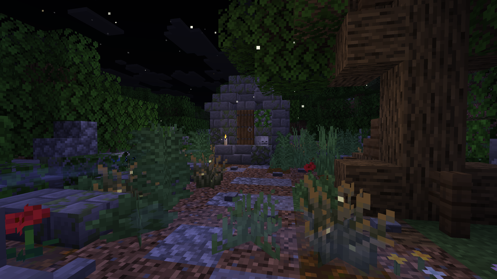

Graveyards are a rare new structure. Each one has graves, a crypt full of [Urns](urn) and a [Gravedigger](gravedigger) with his [Cleaning Station](cleaning_station).

{width=800 align=center caption="One of the new Graveyards"}

## Where to find them

Graveyards generate on the surface in six biome variants:

| Variant | Biomes |
|---|---|
| Forest | Forest, Flower Forest |
| Taiga | Taiga, Old Growth Pine Taiga, Old Growth Spruce Taiga |
| Snowy Taiga | Snowy Taiga |
| Savanna | Savanna |
| Desert | Desert |
| Badlands | Badlands |

They are rare and not easy to come across: there is only one Graveyard attempt per area of 60 by 60 chunks, and it only spawns if the biome fits.

## Loot

| Container | Contents |
|---|---|
| Graves | Bread, Wheat, Emeralds, Gunpowder, String, Rotten Flesh, Bones. Rarely a Diamond, a Name Tag or a [Muddy Item](muddy_items) (15%) |
| [Urns](urn) | Bones, String, Rotten Flesh, Gunpowder, sometimes Emeralds or a Diamond. Rarely a [Muddy Item](muddy_items) (15%), a Name Tag or the [Spirit Manifest](dimensional_rift#spirit-manifest) |
| Gravedigger's chest | A Potion, sometimes a Water Bucket, and always a Crude or Refined [Soap Bar](soap_bars) |
| Decorated Pot | An Emerald or a Diamond |

::: info Credits
Parts of the Graveyard structures were built by **PixelToni153**.
:::
