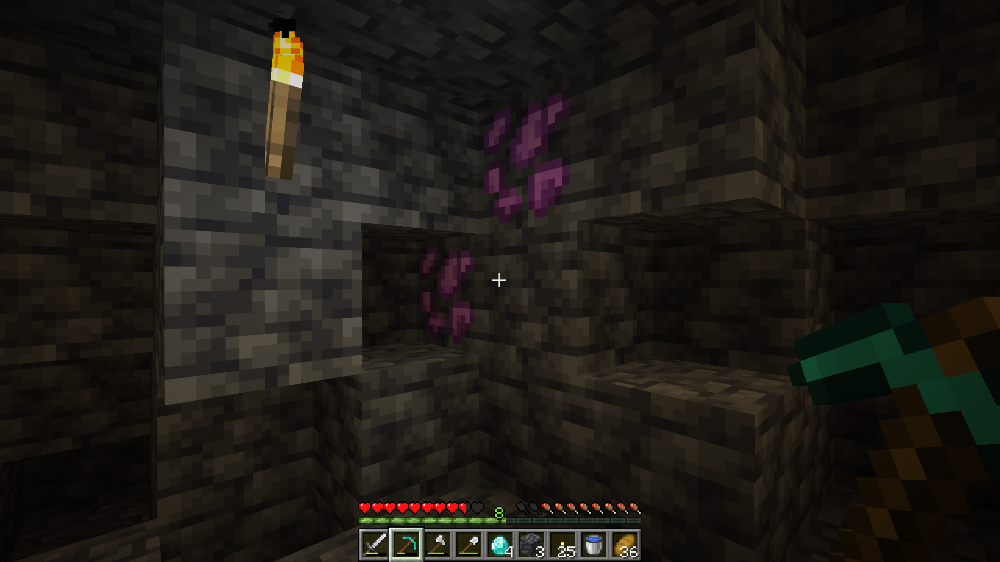
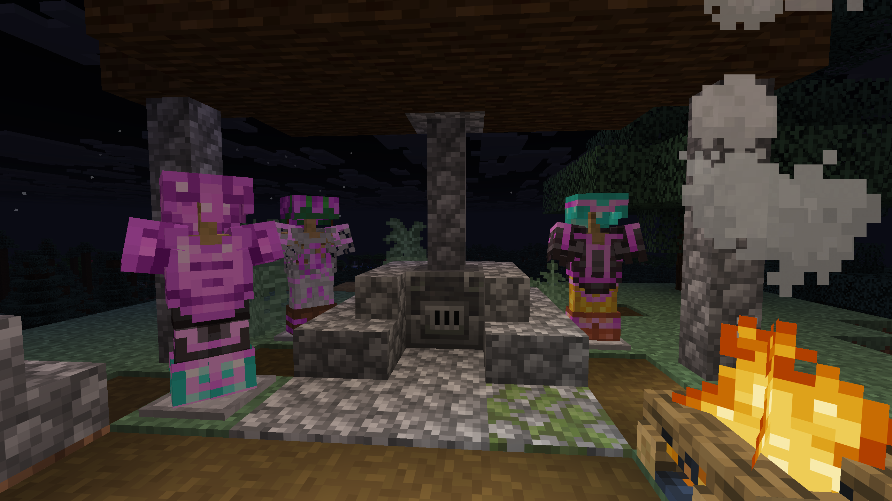

# :icon[images/items/spirit_crystal.png]{size=36} Spirit Crystal

The Spirit Crystal is the main material of Spirit Scape. It is used for [tools](tools_and_weapons), [armor](armor), the Purified [Soap Bar](soap_bars) and as an armor trim material.

{width=800 align=center caption="Spirit Ore Vein"}

## :icon[images/items/spirit_crystal_ore.png]{size=30} :icon[images/items/deepslate_spirit_crystal_ore.png]{size=30} Spirit Crystal Ore

| | Spirit Crystal Ore | Deepslate Spirit Crystal Ore |
|---|:---:|:---:|
| Found in | Stone | Deepslate |
| Height | Y 16 to Y -62 | Y 16 to Y -62 |
| Tool | Diamond Pickaxe or better | Diamond Pickaxe or better |
| Hardness | 15 | 18 |

- The ore is about as rare as Netherite. It generates in small veins of up to 3 blocks and is most common around **Y -23**.
- Mining it drops one **Spirit Crystal**. Fortune increases the amount.
- With Silk Touch, you get the ore block itself.
- Smelting the ore in a Furnace or Blast Furnace also gives a Spirit Crystal.

::: furnace
input: images/items/spirit_crystal_ore.png "Spirit Crystal Ore" | images/items/deepslate_spirit_crystal_ore.png "Deepslate Spirit Crystal Ore"
=> images/items/spirit_crystal.png "Spirit Crystal"
:::

## :icon[images/items/spirit_crystal_block.png]{size=30} Block of Spirit Crystal

A storage block for 9 Spirit Crystals, similar to the Block of Netherite. Unlike Netherite, it can be blown up, for example by End Crystals or Charged Creepers.

::: crafting
A A A
A A A
A A A
A: images/items/spirit_crystal.png "Spirit Crystal"
=> images/items/spirit_crystal_block.png "Block of Spirit Crystal" x1
:::

::: crafting shapeless
A . .
. . .
. . .
A: images/items/spirit_crystal_block.png "Block of Spirit Crystal"
=> images/items/spirit_crystal.png "Spirit Crystal" x9
:::

## Armor trim material

Spirit Crystals can be used as an armor trim material in the Smithing Table. The trim gets a [#e85af5]magenta[/] color.

{width=640 align=center caption="New Spirit Crystal Armor Trim Material"}
