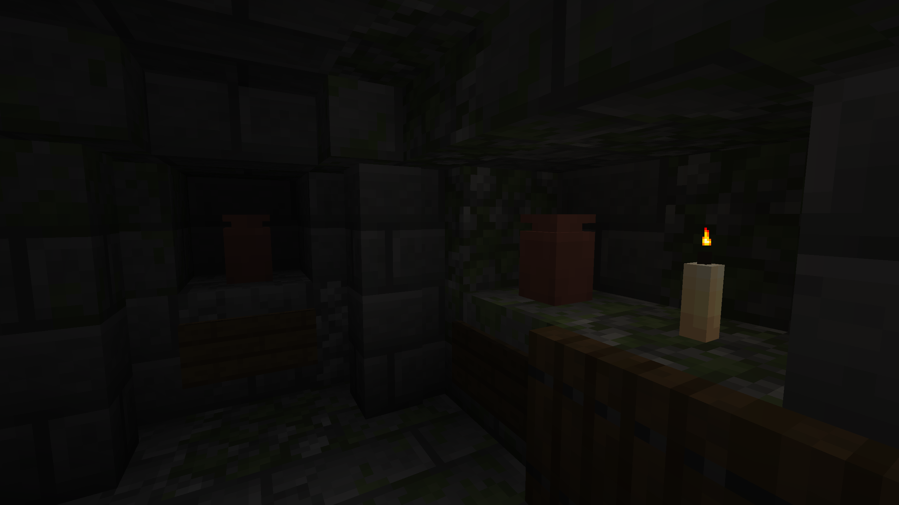

# :icon[images/items/urn.png]{size=36} Urn

The Urn is a decorative block, similar to the Decorated Pot but much smaller. It cannot be decorated, but it can store up to **8 items**, including items that do not stack.

{width=800 align=center caption="Urns within the Crypt"}

## How it works

- Use an item on the Urn to put it inside. It holds **8 items in total**, any mix of different items.
- Like the Decorated Pot, it works with Hoppers and gives a Comparator signal based on how full it is.
- Hitting it with a projectile, for example an arrow, shatters it. A shattered Urn drops **3 Bricks** and its contents instead of itself.

## Crafting

::: crafting
. A .
. A .
. A .
A: images/items/brick.png "Brick"
=> images/items/urn.png "Urn" x1
:::

Urns can also be found in the crypt of [Graveyards](graveyard) or bought from the [Gravedigger](gravedigger).
