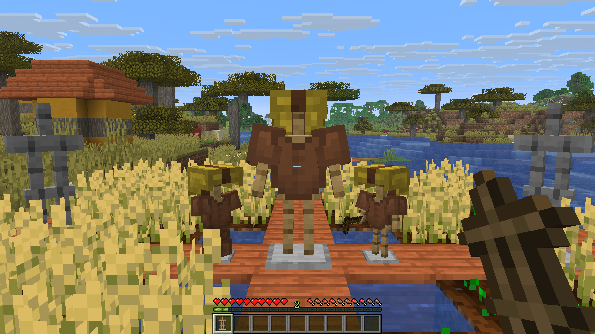

Zephyr adds three new Armor Stand variants and lets you make all of them invisible.

{width=800 align=center caption="New armor stand variants, along with the ability to reveal hidden ones by holding an armor stand in hand."}

## Variants

| Variant | Description |
|---|---|
| :icon[images/items/armor_stand.png]{size=20} Armor Stand | The normal Armor Stand |
| :icon[images/items/armor_stand_with_arms.png]{size=20} Armor Stand with Arms | A normal Armor Stand with arms |
| :icon[images/items/small_armor_stand.png]{size=20} Small Armor Stand | A smaller version, without arms |
| :icon[images/items/small_armor_stand_with_arms.png]{size=20} Small Armor Stand with Arms | A smaller version with arms |

When broken, every Armor Stand drops its own variant and keeps its custom name. Pick Block also gives you the right variant.

## Crafting

::: tabs
@tab With Arms
::: crafting
. . .
A B A
. . .
A: images/items/stick.png "Stick"
B: images/items/armor_stand.png "Armor Stand"
=> images/items/armor_stand_with_arms.png "Armor Stand with Arms" x1
:::
@tab Small
::: crafting
. . .
. A .
A B A
A: images/items/stick.png "Stick"
B: images/items/smooth_stone_slab.png "Smooth Stone Slab"
=> images/items/small_armor_stand.png "Small Armor Stand" x1
:::
@tab Small with Arms
::: crafting
. . .
A B A
. . .
A: images/items/stick.png "Stick"
B: images/items/small_armor_stand.png "Small Armor Stand"
=> images/items/small_armor_stand_with_arms.png "Small Armor Stand with Arms" x1
:::
:::

## Making them invisible

**Sneak** and use an Armor Stand with an **empty hand**. Do the same again to make it visible. Invisible Armor Stands can still be broken.

::: info
While sneaking with an empty hand, you toggle the visibility instead of taking items off the Armor Stand. To take items, use it without sneaking.
:::

## Finding invisible Armor Stands

Similar to Barriers, holding an Armor Stand shows all invisible Armor Stands of the **same variant** around you. For example, holding a Small Armor Stand only shows invisible Small Armor Stands.
