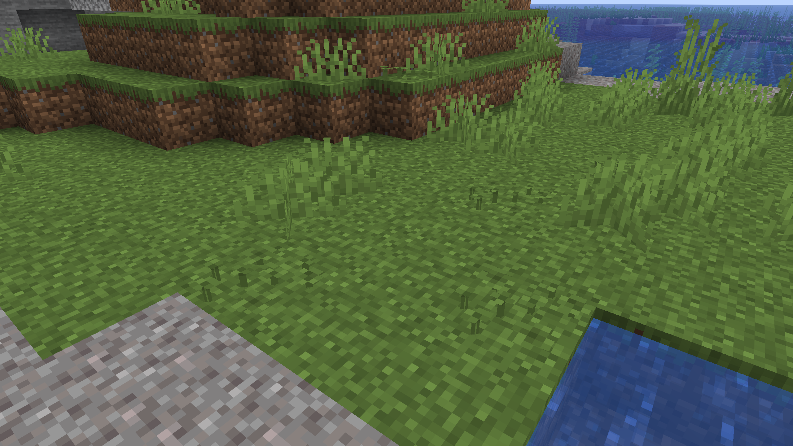
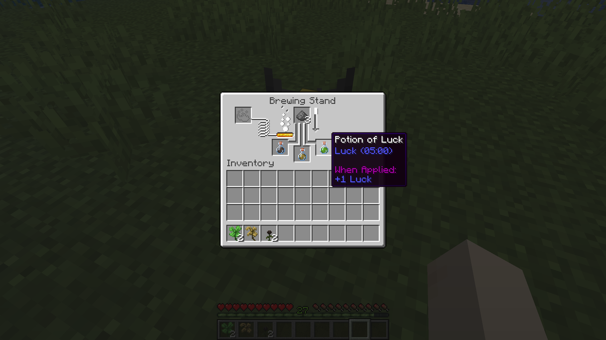

## :icon[images/items/clovers.png]{size=30} Clovers

Clovers are a new grass-like plant that grows in small patches across the Overworld, similar to Bushes.

{width=800 align=center caption="Clovers spawn in small patches around grassy landscapes."}

Breaking Clovers has a small chance to drop one of two new brewing ingredients:

| Drop | Chance |
|---|:---:|
| :icon[images/items/clover.png]{size=20} Clover | 2% |
| :icon[images/items/rotten_clover.png]{size=20} Rotten Clover | 0.5% |

- Fortune increases the amount.
- With Shears, you get the Clovers block itself, which you can place again.

## Potions

The Clover, the Rotten Clover and the Wither Rose can now be used to brew potions.

{width=800 align=center caption="The Clover, Rotten Clover and Wither Rose can be used to brew potions."}

| Potion | Ingredient | Effect | Duration |
|---|---|---|:---:|
| Potion of Luck | Clover | Luck | 5:00 |
| Potion of Luck (long) | + Redstone | Luck | 12:00 |
| Potion of Luck (strong) | + Glowstone Dust | Luck II | 2:30 |
| Potion of Bad Luck | Rotten Clover | Bad Luck | 5:00 |
| Potion of Bad Luck (long) | + Redstone | Bad Luck | 12:00 |
| Potion of Bad Luck (strong) | + Glowstone Dust | Bad Luck II | 2:30 |
| Potion of Decay | Wither Rose | Wither II | 0:40 |

All potions start from an Awkward Potion. Like any other potion, they can be turned into Splash and Lingering Potions and Tipped Arrows.

::: tabs
@tab Luck
::: brewing
ingredient: images/items/clover.png "Clover"
input: potion #385dc6 "Awkward Potion"
=> potion #59c106 "Potion of Luck"
:::
@tab Bad Luck
::: brewing
ingredient: images/items/rotten_clover.png "Rotten Clover"
input: potion #385dc6 "Awkward Potion"
=> potion #c0a44d "Potion of Bad Luck"
:::
@tab Decay
::: brewing
ingredient: images/items/wither_rose.png "Wither Rose"
input: potion #385dc6 "Awkward Potion"
=> potion #736156 "Potion of Decay"
:::
:::

## Advancements

Because of the new potions, two vanilla advancements now need more effects:

| Advancement | New effects |
|---|---|
| A Furious Cocktail | Luck, Bad Luck, Wither |
| How Did We Get Here? | Luck, Bad Luck, Health Boost |

Health Boost comes from the [Vitalis Bottle](illusioner#vitalis-bottle).
