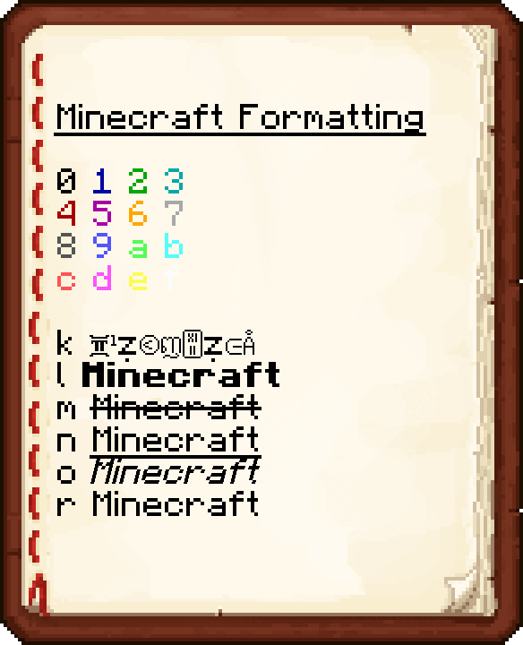

Minecraft has always had formatting codes for colored and styled text, but the `§` character needed to use them was blocked. Zephyr removes this restriction, so you can format text in survival without commands.

{width=640 align=center caption="A book listing the formatting codes, applied by typing '§' followed by the corresponding character."}

## How to use them

Type `§` followed by a code, then your text. Everything after the code is formatted until the next code or `§r`.

```
§6Hello §lWorld§r!
```

This works everywhere you can type text, for example on signs, in books, in the chat and when renaming items in an anvil.

::: tip Typing §
On a German keyboard, press **Shift + 3**. On other layouts, you can copy it from here: `§`
:::

## Colors

| Code | Color |
|:---:|---|
| `§0` | [#000000]Black[/] |
| `§1` | [#0000AA]Dark Blue[/] |
| `§2` | [#00AA00]Dark Green[/] |
| `§3` | [#00AAAA]Dark Aqua[/] |
| `§4` | [#AA0000]Dark Red[/] |
| `§5` | [#AA00AA]Dark Purple[/] |
| `§6` | [#FFAA00]Gold[/] |
| `§7` | [#AAAAAA]Gray[/] |
| `§8` | [#555555]Dark Gray[/] |
| `§9` | [#5555FF]Blue[/] |
| `§a` | [#55FF55]Green[/] |
| `§b` | [#55FFFF]Aqua[/] |
| `§c` | [#FF5555]Red[/] |
| `§d` | [#FF55FF]Light Purple[/] |
| `§e` | [#FFFF55]Yellow[/] |
| `§f` | [#FFFFFF]White[/] |

## Styles

| Code | Style |
|:---:|---|
| `§k` | Obfuscated |
| `§l` | **Bold** |
| `§m` | ~~Strikethrough~~ |
| `§n` | Underlined |
| `§o` | *Italic* |
| `§r` | Reset |

::: info Multiplayer
The server needs Zephyr as well. Without it, the server does not accept the `§` character.
:::
