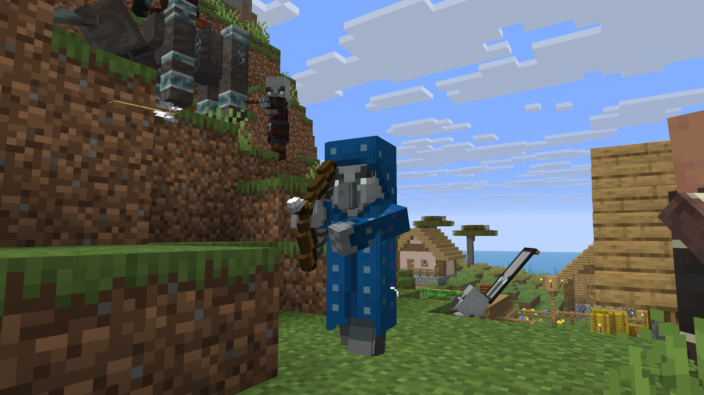
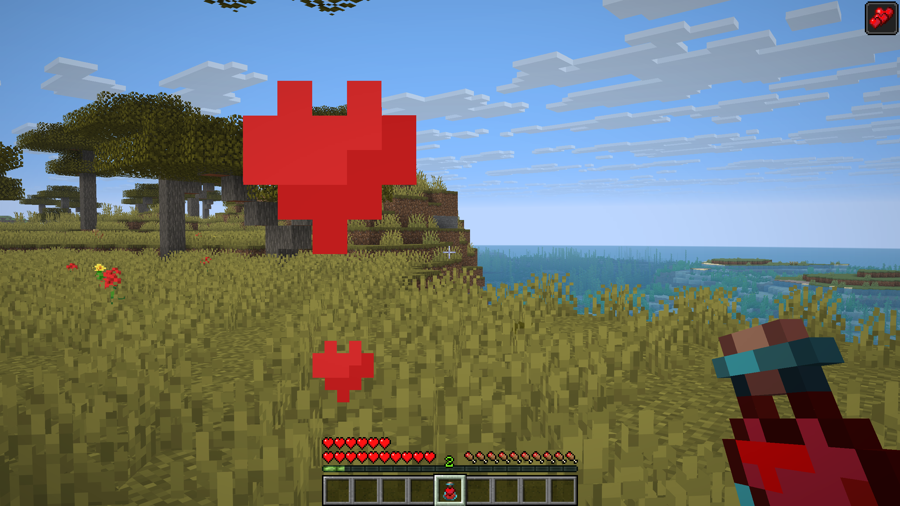

The Illusioner has been in the game files for years, but never appeared naturally. With Zephyr, it joins raids and has its own drops.

{width=800 align=center caption="The Illusioner has a chance to appear in later raid waves."}

## In raids

The Illusioner can appear in the later waves of a raid. The higher the difficulty, the more often it shows up.

| Difficulty | Wave 5 | Wave 6 | Wave 7 | Bonus wave |
|---|:---:|:---:|:---:|:---:|
| Easy | – | – | – | – |
| Normal | 0–1 | – | – | – |
| Hard | 0–1 | 1 | 1 | 1–2, plus 0–1 riding a Ravager |

On Easy and Normal, raids have fewer waves, so the Illusioner only appears from wave 5 on.

## Drops

| Drop | Amount | Notes |
|---|:---:|---|
| :icon[images/items/vitalis_bottle.png]{size=20} Vitalis Bottle | 1 | Always dropped, with a random level from I to V |
| :icon[images/items/emerald.png]{size=20} Emerald | 0–1 | Only when killed by a player. Looting increases the amount |

## :icon[images/items/vitalis_bottle.png]{size=30} Vitalis Bottle

The Vitalis Bottle is nearly identical to the Ominous Bottle, but instead grants **Health Boost** for **50 minutes**.

| Bottle level | Effect |
|:---:|---|
| I | Health Boost I (+2 hearts) |
| II | Health Boost II (+4 hearts) |
| III | Health Boost III (+6 hearts) |
| IV | Health Boost IV (+8 hearts) |
| V | Health Boost V (+10 hearts) |

The level is shown in the tooltip. It is stored in a new data component, see [Data Components](data_components).

{width=800 align=center caption="The Vitalis Bottle gives the Health Boost effect, which has custom particles."}

Health Boost now has its own particle texture, similar to Raid Omen or Trial Omen.

## :icon[images/items/illusioner_spawn_egg.png]{size=30} Spawn egg

The Illusioner has its own spawn egg in the Creative inventory, right after the Evoker Spawn Egg.
