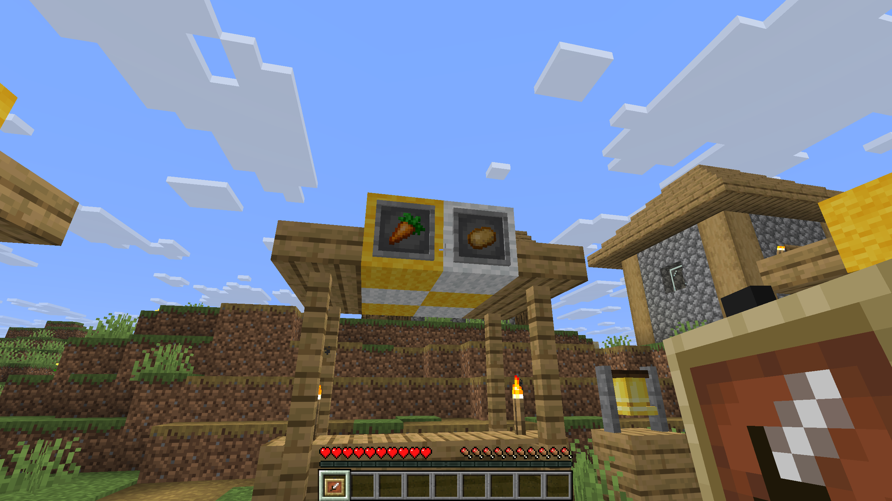

Item Frames and Glow Item Frames can now be made invisible, so only the item inside is visible.

{width=800 align=center caption="Toggle item frame visibility by sneak-clicking with an empty hand, and reveal hidden ones by holding an item frame."}

## Making them invisible

**Sneak** and use an Item Frame with an **empty hand**. Do the same again to make it visible.

## Finding invisible Item Frames

Similar to Barriers, holding an Item Frame in your main hand or off hand shows all invisible Item Frames around you.

| Holding | Shows |
|---|---|
| Item Frame | Invisible Item Frames |
| Glow Item Frame | Invisible Glow Item Frames |
