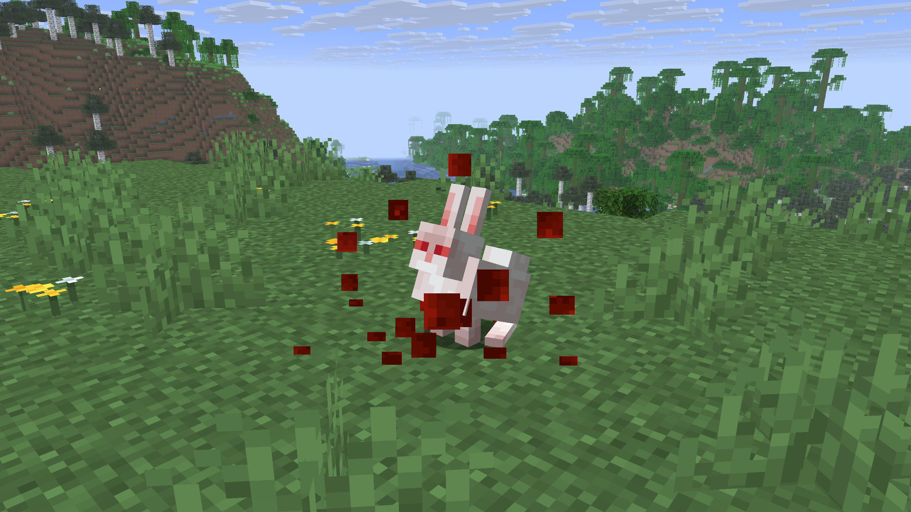

The Killer Bunny is a hostile rabbit variant that normally only appears with commands. With Zephyr, every newly spawned rabbit has a **1% chance** to become a Killer Bunny.

{width=800 align=center caption="The Killer Bunny now has a 1% chance of replacing any newly spawned rabbit."}

- When a rabbit turns into a Killer Bunny, it plays a hurt sound and bursts into red particles.
- Unlike in vanilla, it does not get the name tag "The Killer Bunny" anymore, so it looks like any other mob.
