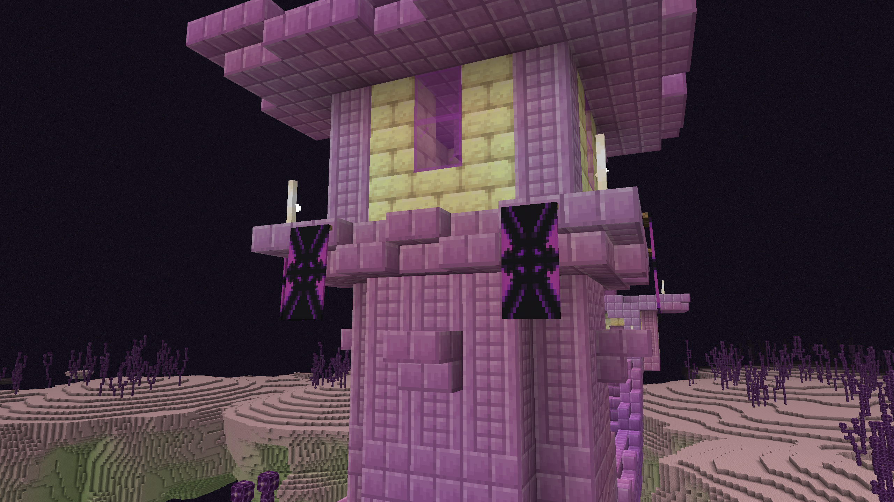

The old End City banner has been replaced with the **Void Banner**, a reworked design that is more in line with the Ominous Banner.

{width=800 align=center caption="The new Void Banner spawning in End Cities."}

- The Void Banner can be found on top of End City towers.
- It is also available in the Creative inventory, right after the Pink Banner.
- Like the Ominous Banner, its patterns are not listed in the tooltip.

::: info
The Void Banner uses more patterns than a Loom allows, so it cannot be recreated in survival.
:::
